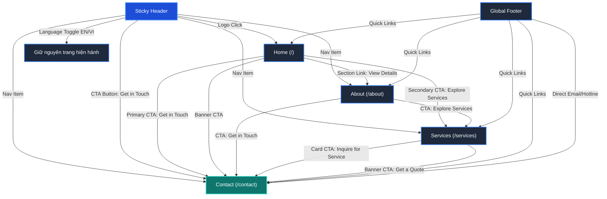
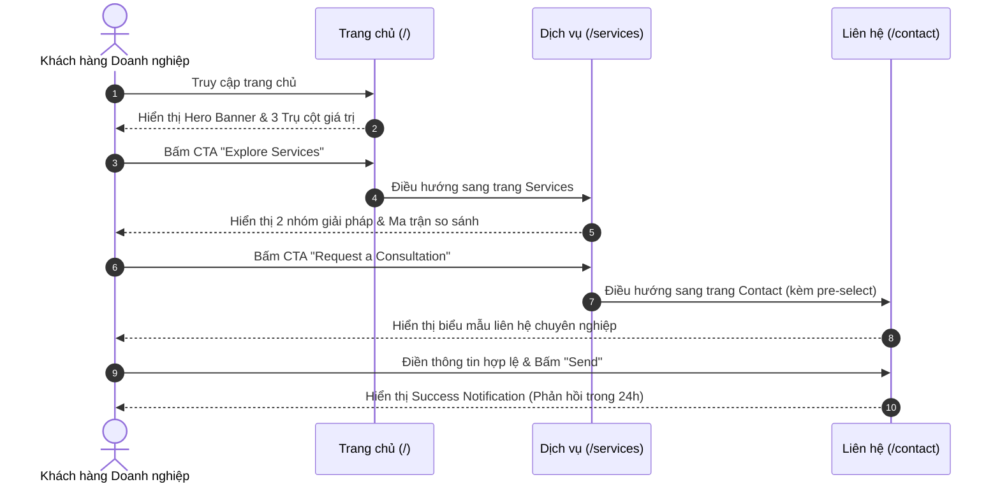
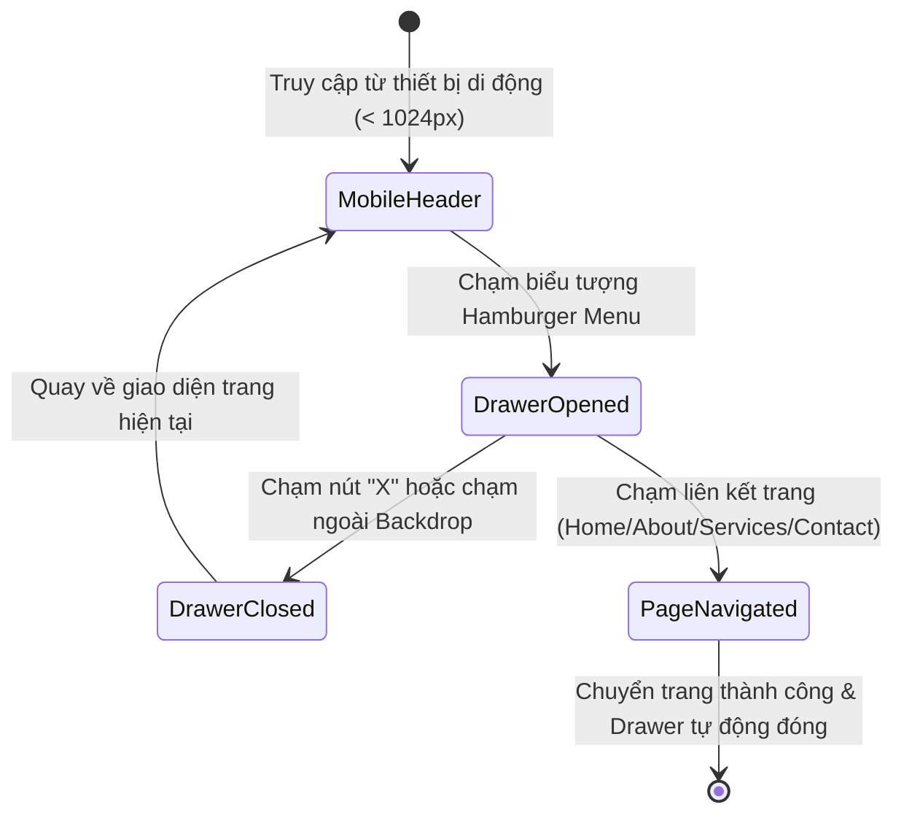

# KIẾN TRÚC THÔNG TIN VÀ LUỒNG NGƯỜI DÙNG (INFORMATION ARCHITECTURE & USER FLOW)
**Dự án:** BIZWORK-IT Website Redesign  
**Mã tài liệu:** `INFORMATION_ARCHITECTURE.md`  
**Giai đoạn:** Giai đoạn 2 — Đặc tả và lập kế hoạch thiết kế  
**Task liên quan:** Task 06 — Kiến trúc thông tin và luồng người dùng  
**Trạng thái:** Nguồn sự thật chính thức cho cấu trúc trang, điều hướng và hành trình trải nghiệm

---

## 1. MỤC ĐÍCH VÀ PHẠM VI (PURPOSE & SCOPE)

### 1.1. Mục đích tài liệu
Tài liệu này xác lập cấu trúc phân cấp trang (Sitemap), bố cục và thứ tự các section trên từng trang, quy chuẩn điều hướng đa nền tảng và hành trình tương tác của người dùng (User Flows) trước khi tiến hành xây dựng Design System và thiết kế giao diện chi tiết.

### 1.2. Phạm vi cấu trúc
- **Trang trong phạm vi:** Đúng 4 trang chính được phê duyệt trong `REQUIREMENTS.md`:
  1. Trang chủ: `/` (Home)
  2. Về chúng tôi: `/about` (About Us)
  3. Dịch vụ: `/services` (Services)
  4. Liên hệ: `/contact` (Contact Us)
- **Ranh giới nghiêm ngặt:** Tuyệt đối không bổ sung các trang ngoài phạm vi (như Blog, Careers, Pricing e-commerce, Dashboard, Login/Register).

---

## 2. NGUỒN THAM CHIẾU (REFERENCES)

Tài liệu được xây dựng hoàn toàn dựa trên các phát hiện thực tế và yêu cầu đã được nghiệm thu:
1. `REQUIREMENTS.md` — Yêu cầu chức năng (`FR-001` đến `FR-013`), yêu cầu giao diện (`UI-001` đến `UI-006`), yêu cầu kỹ thuật (`TR-001` đến `TR-007`), tiêu chí nghiệm thu (`AC-01` đến `AC-13`).
2. `AUDIT_REPORT.md` — Hiện trạng kiến trúc máy chủ DPS GoDaddy, danh mục URL và quy tắc chuyển hướng.
3. `CONTENT_INVENTORY.md` — 32 mục văn bản gốc, 5 tài nguyên media, 4 đồ họa vector và danh mục phân bổ trang.
4. `FUNCTIONALITY_CHECKLIST.md` — Kết quả đo kiểm responsive, hành vi smooth-scroll, form validation và tương tác cookie/chat.
5. `UI_UX_REVIEW.md` — Đánh giá phân cấp thị giác, typography, màu sắc và các ma sát người dùng (friction points).

---

## 3. SITEMAP VÀ PHÂN CẤP TRANG (SITEMAP & PAGE HIERARCHY)

### 3.1. Sơ đồ cây phân cấp cấu trúc (Tree Hierarchy)

```
ROOT LAYOUT (app/layout.tsx)
 ├── GLOBAL PROVIDERS (Theme, Localization EN/VI)
 ├── STICKY HEADER (Logo, Nav 4 Links, Language Switcher, CTA Button)
 │
 ├── [Trang 1] / (Home - app/page.tsx)
 │    ├── Section 1: Hero Banner (H1 Tagline, Core Value, Dual CTA)
 │    ├── Section 2: Core Value Pillars (3 thế mạnh: Tech Experience, High ROI, Satisfaction)
 │    ├── Section 3: Services Overview (Tóm lược 2 nhóm giải pháp IT & Link)
 │    ├── Section 4: Working Process (Quy trình làm việc 4 bước chuẩn B2B)
 │    └── Section 5: Bottom CTA Banner (Kêu gọi hành động tư vấn)
 │
 ├── [Trang 2] /about (About Us - app/about/page.tsx)
 │    ├── Section 1: Page Header / Hero (Sứ mệnh "We make technology accessible!")
 │    ├── Section 2: Corporate Profile & Entity (Pháp nhân BIZWORKIT (S) PTE LTD)
 │    ├── Section 3: Commitment & Philosophy ("Satisfaction Guaranteed", may đo theo ngân sách)
 │    ├── Section 4: Technical Capabilities (Kinh nghiệm đa hệ điều hành, mạng, CSDL)
 │    └── Section 5: Transition CTA (Dẫn hướng tới Services & Contact)
 │
 ├── [Trang 3] /services (Services - app/services/page.tsx)
 │    ├── Section 1: Page Header / Hero (Giải pháp IT toàn diện cho SMBs)
 │    ├── Section 2: Solution 1 - Technical Support & Infrastructure
 │    ├── Section 3: Solution 2 - IT Management Outsourcing (High ROI)
 │    ├── Section 4: In-House IT vs. BIZWORK-IT Outsourcing (Ma trận so sánh giá trị)
 │    ├── Section 5: FAQ Accordion (Giải đáp câu hỏi thường gặp)
 │    └── Section 6: Consultation CTA Banner (Kêu gọi liên hệ báo giá)
 │
 ├── [Trang 4] /contact (Contact Us - app/contact/page.tsx)
 │    ├── Section 1: Page Header / Hero ("Contact Us" - Drop us a line!)
 │    ├── Section 2: Interactive Contact Form (Name, Email*, Service Category, Message, Attachment)
 │    ├── Section 3: Direct Business Info (Legal Entity, Singapore Office, Email, Hotline)
 │    └── Section 4: Trust & Privacy Assurance (Bảo mật thông tin khách hàng)
 │
 └── GLOBAL FOOTER (app/components/Footer.tsx)
      ├── Brand Identity & Tagline
      ├── Quick Navigation (4 Pages)
      ├── Corporate Information (Singapore Entity)
      └── Copyright © 2025 BIZWORK-IT
```

### 3.2. Quy tắc xử lý URL cũ và Canonical Paths
- **Canonical URLs:** Mọi URL nội bộ sử dụng đường dẫn chuẩn hóa (clean URLs không có dấu gạch chéo cuối thừa):
  - `https://bizwork-it.com/`
  - `https://bizwork-it.com/about`
  - `https://bizwork-it.com/services`
  - `https://bizwork-it.com/contact`
- **Tương thích ngược với liên kết cũ (Backward Compatibility):**
  - Anchor URL cũ trên GoDaddy: `/#f3a9405b-249e-4d48-9175-b3b8ee945a5b` được tự động chuyển hướng hoặc cuộn mượt tới section biểu mẫu tại `/contact`.

---

## 4. SƠ ĐỒ ĐIỀU HƯỚNG VÀ MẠNG LIÊN KẾT NỘI BỘ (NAVIGATION GRAPH)



---

## 5. ĐẶC TẢ CẤU TRÚC TRANG CHỦ (HOME — `/`)

- **Mục tiêu trang:** Tạo ấn tượng chuyên nghiệp đầu tiên (Modern Tech Enterprise), định vị năng lực, truyền tải 3 trụ cột giá trị cốt lõi và kích thích người dùng chuyển đổi tới trang Dịch vụ và Liên hệ.
- **Đối tượng:** Doanh nghiệp SMBs, nhà quản lý đang tìm kiếm đối tác IT chuyên nghiệp, tiết kiệm chi phí.
- **Ý định chính:** Nắm bắt nhanh BIZWORK-IT làm gì, tại sao nên tin tưởng và cách thức liên hệ.

### Bảng cấu trúc Section trang Home:

| Thứ tự | Tên Section | Mục tiêu người dùng | Chi tiết nội dung hiển thị | CTA / Liên kết nội bộ | Mã yêu cầu | Ghi chú & Nguồn audit |
| :---: | :--- | :--- | :--- | :--- | :---: | :--- |
| **H-01** | **Hero Banner** | Hiểu ngay lập tức lĩnh vực hoạt động và giá trị cốt lõi | - Tiêu đề chính H1: *"Professional Technology Assistance"* (TXT-002).<br>- Khẩu hiệu định vị: *"We make technology accessible!"* (TXT-003).<br>- Đoạn mô tả ngắn về giải pháp IT tối ưu cho SMBs.<br>- Đồ họa công nghệ hiện đại thay thế cho ảnh stock bo mạch cũ (MED-001). | - Primary CTA: `"Get in Touch"` dẫn tới `/contact`.<br>- Secondary CTA: `"Explore Services"` dẫn tới `/services`. | `FR-001`<br>`FR-005`<br>`UI-001` | Khắc phục tiêu đề nhân đôi H1 trên web cũ. |
| **H-02** | **Core Value Pillars** | Nhận diện 3 lý do cốt lõi để chọn BIZWORK-IT | 3 thẻ Card công nghệ hiện đại:<br>1. *Technical Experience:* Hỗ trợ hệ điều hành, mạng, CSDL (TXT-007, 008).<br>2. *High ROI:* Quản trị IT thuê ngoài giúp tối ưu ngân sách (TXT-009, 010).<br>3. *Satisfaction Guaranteed:* Cam kết dịch vụ chuyên nghiệp (TXT-011, 012). | Mỗi card có icon vector và link vi tương tác tới section chi tiết ở `/services` hoặc `/about`. | `FR-001`<br>`UI-002`<br>`UI-006` | Kế thừa 100% nội dung gốc đã xác minh từ Task 02. |
| **H-03** | **Services Overview** | Nắm bắt tổng quan 2 nhóm dịch vụ chính mà công ty cung cấp | - Tiêu đề H2: Các giải pháp CNTT toàn diện.<br>- Tóm tắt nhóm 1: Hỗ trợ kỹ thuật & Cơ sở hạ tầng.<br>- Tóm tắt nhóm 2: Quản trị IT thuê ngoài (IT Management Outsourcing). | CTA Link: `"View All Services →"` dẫn tới `/services`. | `FR-001`<br>`FR-005` | Cung cấp cái nhìn tổng thể trước khi chuyển trang. |
| **H-04** | **Working Methodology** | Thấy được quy trình hợp tác minh bạch, rõ ràng | Quy trình làm việc 4 bước chuẩn hóa B2B:<br>1. *Tiếp nhận yêu cầu* (Inquiry & Discovery).<br>2. *Đánh giá hệ thống* (System Assessment).<br>3. *Triển khai giải pháp* (Tailored Implementation).<br>4. *Bảo trì & Hỗ trợ liên tục* (Ongoing Support). | CTA Link: `"Learn More About Us →"` dẫn tới `/about`. | `FR-011`<br>`UI-001` | Đáp ứng yêu cầu SHOULD HAVE giải quyết điểm yếu UX cũ. |
| **H-05** | **Conversion CTA Banner** | Kích hoạt hành động gửi yêu cầu tư vấn trước khi rời trang | - Tiêu đề: Sẵn sàng nâng cấp hạ tầng CNTT cho doanh nghiệp của bạn?<br>- Mô tả: Đội ngũ kỹ sư BIZWORK-IT sẵn sàng hỗ trợ giải pháp phù hợp nhất với ngân sách. | Primary CTA: `"Contact Our Engineers"` dẫn tới `/contact`. | `FR-005`<br>`UI-002` | Tối ưu điểm chạm chuyển đổi cuối trang. |

---

## 6. ĐẶC TẢ CẤU TRÚC TRANG GIỚI THIỆU (ABOUT — `/about`)

- **Mục tiêu trang:** Xây dựng uy tín và sự tin cậy thông qua thông tin pháp nhân chính thức, sứ mệnh kinh doanh và cam kết đồng hành bền vững cùng khách hàng doanh nghiệp.
- **Đối tượng:** Khách hàng cần thẩm định năng lực pháp lý, triết lý phục vụ và cam kết chất lượng trước khi ký kết dịch vụ.
- **Ý định chính:** Xác minh tính minh bạch, chuyên nghiệp của BIZWORKIT (S) PTE LTD.

### Bảng cấu trúc Section trang About:

| Thứ tự | Tên Section | Mục tiêu người dùng | Chi tiết nội dung hiển thị | CTA / Liên kết nội bộ | Mã yêu cầu | Ghi chú & Nguồn audit |
| :---: | :--- | :--- | :--- | :--- | :---: | :--- |
| **A-01** | **Page Header / Hero** | Xác nhận vị trí trang và thông điệp sứ mệnh | - Tiêu đề H1: *"About Us"* (TXT-006) / *"Về chúng tôi"*.<br>- Khẩu hiệu: *"We make technology accessible!"* (TXT-003).<br>- Lời mở đầu về định hướng hỗ trợ công nghệ cho cộng đồng doanh nghiệp vừa và nhỏ. | Breadcrumb: `Home > About`. | `FR-001`<br>`FR-009` | Chuẩn hóa cấu trúc heading ngữ nghĩa SEO. |
| **A-02** | **Corporate Profile & Entity** | Thẩm định tư cách pháp nhân chính thức | - Tên pháp nhân đăng ký: `BIZWORKIT (S) PTE LTD` (TXT-023).<br>- Trụ sở hoạt động: `Singapore` (TXT-024).<br>- Tôn chỉ hoạt động: Đơn giản hóa công nghệ, đưa các giải pháp IT tiêu chuẩn doanh nghiệp lớn đến với quy mô SMBs với chi phí tối ưu. | Liên kết tới thông tin liên hệ tại `/contact`. | `FR-001`<br>`UI-001` | Tuyệt đối không bịa số liệu thành tích chưa xác minh. |
| **A-03** | **Customer Commitment** | Tin tưởng vào cam kết chất lượng dịch vụ | - Tiêu đề H2: *"Satisfaction Guaranteed"* (TXT-011).<br>- Nội dung cam kết: Công nghệ biến đổi nhanh chóng có thể gây choáng ngợp; BIZWORK-IT cam kết mang lại trải nghiệm được may đo chính xác theo nhu cầu và ngân sách, đảm bảo sự hài lòng tuyệt đối (TXT-012). | Điểm nhấn trực quan (Quote / Highlight Card). | `FR-001`<br>`UI-002` | Kế thừa nguyên văn cam kết thương mại đã kiểm chứng. |
| **A-04** | **Technical Core Strengths** | Hiểu rõ phạm vi năng lực công nghệ | - Tiêu đề H2: Năng lực chuyên môn vững chắc.<br>- Chi tiết năng lực: Am hiểu đa dạng các hệ điều hành (Windows, Linux), mạng viễn thông, cơ sở dữ liệu và hạ tầng văn phòng (TXT-008). | CTA Link: `"Discover Our Services →"` dẫn tới `/services`. | `FR-001`<br>`FR-005` | Dẫn dòng người dùng tìm hiểu sâu về dịch vụ. |
| **A-05** | **Partnership CTA Banner** | Chuyển đổi người dùng tin tưởng sang bước hành động | Lời mời hợp tác: Đồng hành cùng BIZWORK-IT để an tâm vận hành và phát triển kinh doanh. | Primary CTA: `"Get in Touch With Us"` dẫn tới `/contact`. | `FR-005` | Khép lại trang bằng điểm chuyển đổi rõ ràng. |

---

## 7. ĐẶC TẢ CẤU TRÚC TRANG DỊCH VỤ (SERVICES — `/services`)

- **Mục tiêu trang:** Trình bày chi tiết, mạch lạc 2 nhóm dịch vụ IT chính dựa trên bằng chứng thực tế, phân tích lợi ích kinh tế (High ROI) và giải đáp thắc mắc để thuyết phục khách hàng gửi yêu cầu tư vấn.
- **Đối tượng:** Quản lý doanh nghiệp, phụ trách IT đang đối mặt với bài toán chi phí bảo trì hoặc thiếu hụt nhân sự kỹ thuật.
- **Ý định chính:** Tìm hiểu gói dịch vụ phù hợp và so sánh hiệu quả đầu tư.

### Bảng cấu trúc Section trang Services:

| Thứ tự | Tên Section | Mục tiêu người dùng | Chi tiết nội dung hiển thị | CTA / Liên kết nội bộ | Mã yêu cầu | Ghi chú & Nguồn audit |
| :---: | :--- | :--- | :--- | :--- | :---: | :--- |
| **S-01** | **Page Header / Hero** | Nhận diện danh mục giải pháp công nghệ | - Tiêu đề H1: *"Our Services"* / *"Dịch vụ của chúng tôi"*.<br>- Mô tả: Cung cấp giải pháp hỗ trợ kỹ thuật và quản trị hạ tầng CNTT toàn diện cho doanh nghiệp. | Breadcrumb: `Home > Services`. | `FR-001`<br>`FR-009` | Metadata chuyên biệt cho từ khóa dịch vụ. |
| **S-02** | **Solution 1: Technical Support** | Nắm rõ năng lực hỗ trợ cơ sở hạ tầng | - Tiêu đề H2: *"Technical Experience & Assistance"* (TXT-007).<br>- Nội dung: Chuyên môn sâu về hệ điều hành, cấu hình mạng, cơ sở dữ liệu và xử lý sự cố thiết bị cho các dự án vừa và nhỏ (TXT-008).<br>- Danh mục hạng mục: Quản trị OS, thiết lập Network Router/Firewall, Database Management. | CTA: `"Inquire About Tech Support"` mở modal hoặc cuộn `/contact?service=tech-support`. | `FR-001`<br>`FR-006` | Chỉ sử dụng năng lực đã xác minh, không bịa dịch vụ mới. |
| **S-03** | **Solution 2: IT Outsourcing** | Nhận thấy giá trị kinh tế của việc thuê ngoài | - Tiêu đề H2: *"High ROI — IT Management Outsourcing"* (TXT-009).<br>- Nội dung: Giải quyết vấn đề ngân sách bị bào mòn bởi việc bảo trì hệ thống cũ; dịch vụ thuê ngoài giúp doanh nghiệp tối ưu chi phí và giải phóng nguồn lực tập trung kinh doanh (TXT-010). | CTA: `"Get Outsourcing Consultation"` dẫn tới `/contact?service=outsourcing`. | `FR-001`<br>`FR-006` | Nhấn mạnh giải pháp High ROI từ dữ liệu gốc. |
| **S-04** | **Value Comparison Matrix** | So sánh trực quan lợi ích giữa 2 mô hình | Bảng so sánh 4 tiêu chí cốt lõi:<br>1. *Chi phí nhân sự:* Thuê IT nội bộ toàn thời gian vs. Thuê ngoài linh hoạt.<br>2. *Chuyên môn kỹ thuật:* Phụ thuộc cá nhân vs. Đội ngũ đa nền tảng.<br>3. *Thời gian phản hồi:* Bị động vs. Cam kết SLA hỗ trợ.<br>4. *Ngân sách đầu tư:* Chi phí phát sinh cao vs. Định mức rõ ràng. | Minh họa bảng so sánh bằng bảng Responsive. | `FR-001`<br>`UI-001` | Gia tăng tính thuyết phục logic cho khách hàng B2B. |
| **S-05** | **Frequently Asked Questions** | Xóa bỏ rào cản và thắc mắc trước khi liên hệ | Khối Accordion 4 câu hỏi thực tế:<br>- BIZWORK-IT có hỗ trợ doanh nghiệp quy mô nhỏ không?<br>- Quy trình tiếp nhận và thời gian phản hồi sự cố ra sao?<br>- Dữ liệu doanh nghiệp được bảo mật như thế nào?<br>- Chi phí dịch vụ được tính toán theo mô hình nào? | Mở/đóng accordion mượt mà có hỗ trợ bàn phím. | `FR-012`<br>`UI-006` | Yêu cầu SHOULD HAVE trong REQUIREMENTS.md. |
| **S-06** | **Service Consultation CTA** | Kích hoạt gửi yêu cầu cho gói dịch vụ đã chọn | - Tiêu đề: Cần tư vấn giải pháp IT phù hợp nhất cho công ty của bạn?<br>- Nút chuyển đổi trực tiếp kèm định tuyến chọn trước dịch vụ. | Primary CTA: `"Request a Free Consultation"` dẫn tới `/contact`. | `FR-005` | Điểm chuyển đổi cuối trang Services. |

---

## 8. ĐẶC TẢ CẤU TRÚC TRANG LIÊN HỆ (CONTACT — `/contact`)

- **Mục tiêu trang:** Tiếp nhận thông tin yêu cầu tư vấn, cung cấp kênh liên hệ trực tiếp minh bạch và tạo cảm giác an tâm tối đa cho khách hàng khi chia sẻ thông tin doanh nghiệp.
- **Đối tượng:** Khách hàng đã sẵn sàng gửi yêu cầu, cần báo giá hoặc muốn kết nối trực tiếp với đại diện BIZWORK-IT.
- **Ý định chính:** Điền form nhanh chóng, không gặp lỗi, biết rõ thông tin liên hệ và thời gian phản hồi.

### Bảng cấu trúc Section trang Contact:

| Thứ tự | Tên Section | Mục tiêu người dùng | Chi tiết nội dung hiển thị | CTA / Liên kết nội bộ | Mã yêu cầu | Ghi chú & Nguồn audit |
| :---: | :--- | :--- | :--- | :--- | :---: | :--- |
| **C-01** | **Page Header / Hero** | Xác nhận trang và tạo lời mời thân thiện | - Tiêu đề H1: *"Contact Us"* (TXT-013) / *"Liên hệ với chúng tôi"*.<br>- Lời mời nồng nhiệt: *"Drop us a line!"* (TXT-014) và *"Better yet, see us in person!"* (TXT-022). | Breadcrumb: `Home > Contact`. | `FR-001`<br>`FR-009` | Kế thừa 100% câu chữ mời gọi từ web cũ. |
| **C-02** | **Interactive Contact Form** | Nhập thông tin nhu cầu một cách dễ dàng và chính xác | Bố cục Form 2 cột trên desktop / 1 cột trên mobile:<br>- Họ tên (`Name`): Bắt buộc.<br>- Thư điện tử (`Email*`): Bắt buộc, kiểm tra Regex.<br>- Danh mục dịch vụ (`Service Category`): Dropdown (IT Support / IT Outsourcing / Tư vấn chung).<br>- Tin nhắn (`Message`): Textarea 4 dòng.<br>- Đính kèm tệp (`Attach Files`): Hỗ trợ chọn tệp, giới hạn tối đa 10MB.<br>- Nút gửi (`Send` / `Gửi tin nhắn`). | 4 trạng thái form:<br>1. Default.<br>2. Validation Error.<br>3. Submitting (Loading).<br>4. Success Toast. | `FR-006`<br>`FR-007`<br>`UI-004` | Khắc phục điểm yếu thiếu phân loại dịch vụ của form cũ. |
| **C-03** | **Direct Business Information** | Tìm thông tin địa chỉ, email và hotline chính thức | Khối thông tin kết nối bên cạnh form:<br>- Tên pháp nhân: `BIZWORKIT (S) PTE LTD` (TXT-023).<br>- Địa điểm: `Singapore` (TXT-024) kèm cấu hình chi tiết `PC-01`.<br>- Email hỗ trợ: Placeholder cấu hình `contact@bizwork-it.com` (`PC-02`).<br>- Hotline: Placeholder cấu hình (`PC-02`).<br>- Giờ làm việc tiêu chuẩn: Thứ 2 - Thứ 6 (9:00 - 18:00 SGT). | Click-to-call link cho hotline, click-to-email cho địa chỉ mail. | `FR-001`<br>`UI-001` | Khắc phục tình trạng thiếu hotline/email của web cũ. |
| **C-04** | **Security & Privacy Assurance** | Yên tâm về tính bảo mật dữ liệu | Thông báo bảo vệ quyền riêng tư: Cam kết thông tin khách hàng được bảo mật tuyệt đối, không chia sẻ cho bên thứ ba, tuân thủ các tiêu chuẩn bảo mật dữ liệu hiện hành (TXT-021). | Liên kết tới chính sách bảo mật nội bộ. | `FR-006`<br>`FR-010` | Thay thế text liên kết reCAPTCHA trần của web cũ. |

---

## 9. QUY TẮC HEADER, FOOTER VÀ ĐIỀU HƯỚNG DÙNG CHUNG

### 9.1. Thanh điều hướng đầu trang (Sticky Header)
- **Cơ chế Sticky:** Header cố định ở vị trí `top: 0`, `z-index: 50`. Khi người dùng cuộn trang xuống, Header áp dụng hiệu ứng nền mờ bán trong suốt (Glassmorphism backdrop-blur: `rgba(15, 23, 42, 0.85)` trên nền tối hoặc `rgba(255, 255, 255, 0.9)` trên nền sáng) kèm đường viền mỏng phía dưới (`border-b border-slate-200/20`) để tách biệt nội dung cuộn.
- **Bố cục Desktop ($\ge 1024$px):**
  - Trái: Logo text `BIZWORK-IT` (Typography đậm nét, hover chuyển màu nhẹ).
  - Giữa: Menu 4 liên kết (`Home`, `About`, `Services`, `Contact`) với khoảng cách $32$px.
  - Phải: Cụm chức năng gồm Nút chuyển đổi ngôn ngữ (`EN | VI`) và Nút Primary CTA (`Get in Touch`).
- **Trạng thái Active:** Liên kết của trang hiện hành được làm nổi bật bằng màu Primary Blue (`#2563EB`) và một thanh gạch dưới tinh tế (active indicator bar $2$px).
- **Bố cục Mobile ($< 1024$px):**
  - Trái: Logo text `BIZWORK-IT`.
  - Phải: Cụm Nút chuyển đổi `EN | VI` và Nút Hamburger Menu (icon SVG 3 thanh ngang).
  - Drawer Menu: Khi bấm nút Hamburger, menu trượt ra từ bên phải màn hình chiếm $85\%$ chiều rộng, có lớp phủ mờ (backdrop overlay), hiển thị 4 liên kết trang kích thước lớn (chiều cao touch target $\ge 48$px) và nút CTA ở dưới cùng. Nút đóng `"X"` ở góc trên bên phải.

### 9.2. Chân trang (Global Footer)
- **Bố cục đa cột (4 cột trên Desktop, 2 cột trên Tablet, 1 cột xếp chồng trên Mobile):**
  - **Cột 1 (Thương hiệu):** Logo `BIZWORK-IT`, khẩu hiệu *"We make technology accessible!"* và tóm tắt năng lực hỗ trợ công nghệ chuyên nghiệp.
  - **Cột 2 (Điều hướng nhanh):** Liên kết tới 4 trang (`Home`, `About`, `Services`, `Contact`).
  - **Cột 3 (Pháp nhân & Địa chỉ):** Pháp nhân `BIZWORKIT (S) PTE LTD`, trụ sở Singapore, giờ làm việc.
  - **Cột 4 (Kênh kết nối):** Email liên hệ hỗ trợ, Hotline, Nút dẫn tới form liên hệ.
- **Thanh bản quyền dưới cùng (Bottom Bar):**
  - Bản quyền: `Copyright © 2025 BIZWORK-IT - All Rights Reserved.` (TXT-025).
  - Loại bỏ hoàn toàn dòng quảng cáo *"Powered by GoDaddy"* của web cũ.

---

## 10. QUY TẮC CHUYỂN ĐỔI NGÔN NGỮ EN / VI (LOCALIZATION RULES)

1. **Giữ nguyên định tuyến tại chỗ (In-Place Route Retention):**
   - Khi người dùng đang ở bất kỳ trang nào (ví dụ: `/services`) và bấm nút chuyển đổi ngôn ngữ sang `VI`, trang web **phải giữ nguyên tại `/services`** và hiển thị toàn bộ nội dung dịch tương ứng bằng tiếng Việt.
   - **Tuyệt đối cấm:** Hành vi tự ý chuyển hướng người dùng về trang chủ `/` khi đổi ngôn ngữ.
2. **Cơ chế lưu trữ phiên (State Persistence):**
   - Lựa chọn ngôn ngữ của người dùng được lưu trữ trong `localStorage` (khóa `bizwork_lang: 'en' | 'vi'`) và đồng bộ hóa qua Cookie nhẹ để đảm bảo khi tải lại trang hoặc mở tab mới, ngôn ngữ đã chọn được giữ nguyên vẹn.
3. **Cập nhật Metadata & Thẻ HTML:**
   - Khi chọn `EN`: Thẻ `<html lang="en">`, tiêu đề và meta description hiển thị tiếng Anh.
   - Khi chọn `VI`: Thẻ `<html lang="vi">`, tiêu đề và meta description chuyển ngữ tiếng Việt tương ứng.
4. **Nhất quán từ điển bản ngữ (Dictionary Consistency):**
   - Không dịch tên riêng pháp nhân: `BIZWORKIT (S) PTE LTD` và tên thương hiệu `BIZWORK-IT` giữ nguyên trên cả 2 ngôn ngữ.
   - Các thuật ngữ chuyên ngành IT (ROI, OS, Database, Network, IT Outsourcing) được giữ nguyên chuẩn quốc tế kèm giải thích tiếng Việt rõ nghĩa.

---

## 11. HỆ THỐNG LUỒNG NGƯỜI DÙNG CHI TIẾT (USER FLOWS)

### Luồng 1: Tìm hiểu dịch vụ từ Trang chủ đến Gửi liên hệ (Primary B2B Journey)
- **Điểm bắt đầu:** Khách hàng truy cập trang chủ `https://bizwork-it.com/`.
- **Các bước tương tác:**
  1. Người dùng đọc Hero Banner, nắm bắt thông điệp *"Professional Technology Assistance"*.
  2. Cuộn qua 3 trụ cột giá trị (*Technical Experience*, *High ROI*, *Satisfaction Guaranteed*).
  3. Đến Section Services Overview, thấy gói dịch vụ phù hợp và bấm nút `"Explore Services"`.
  4. Trình duyệt chuyển sang trang `/services`. Người dùng xem chi tiết 2 nhóm giải pháp và bảng so sánh lợi ích ROI.
  5. Người dùng bấm nút CTA `"Request a Consultation"`.
  6. Trình duyệt chuyển sang trang `/contact` với trường `Service Category` được chọn trước.
  7. Người dùng điền Form và bấm `"Send"`.
- **Trang / Trạng thái đích:** Thông báo gửi thành công (Success Toast) trên `/contact`.
- **Ngoại lệ / Xử lý lỗi:** Nếu người dùng nhập sai email, form hiển thị cảnh báo đỏ ngay tại ô nhập liệu và giữ nguyên nội dung tin nhắn đã gõ.



---

### Luồng 2: Vào trực tiếp Dịch vụ từ công cụ tìm kiếm và Gửi yêu cầu
- **Điểm bắt đầu:** Khách hàng tìm kiếm từ khóa trên Google và truy cập thẳng vào URL `https://bizwork-it.com/services`.
- **Các bước tương tác:**
  1. Trang `/services` hiển thị ngay lập tức với tiêu đề dịch vụ rõ ràng, không bị phụ thuộc trang chủ.
  2. Người dùng đọc nội dung giải pháp *IT Management Outsourcing* và xem phần *FAQ Accordion*.
  3. Bấm mở câu hỏi FAQ để xem thời gian cam kết hỗ trợ.
  4. Bấm nút CTA `"Get a Quote"` ngay dưới khối dịch vụ.
  5. Trình duyệt chuyển hướng mượt mà sang `/contact`.
- **Trang / Trạng thái đích:** Trang `/contact` sẵn sàng nhận dữ liệu.
- **Ngoại lệ:** Người dùng muốn xem lại uy tín công ty trước khi gửi: Bấm liên kết `About Us` trên Header -> chuyển sang `/about`, sau đó bấm CTA tại `/about` để quay lại `/contact`.

---

### Luồng 3: Thẩm định pháp nhân từ trang Giới thiệu đến Liên hệ
- **Điểm bắt đầu:** Khách hàng truy cập trang `/about` để tìm hiểu về BIZWORK-IT.
- **Các bước tương tác:**
  1. Đọc thông tin pháp nhân `BIZWORKIT (S) PTE LTD` và vị trí tại Singapore.
  2. Đọc cam kết chất lượng *"Satisfaction Guaranteed"*.
  3. Nhận thấy công ty minh bạch, uy tín và phù hợp với tiêu chuẩn chọn đối tác.
  4. Bấm nút CTA `"Get in Touch With Us"` ở cuối trang `/about`.
- **Trang / Trạng thái đích:** Điều hướng sang `/contact`.
- **Kết quả mong đợi:** Người dùng điền biểu mẫu với mức độ tin tưởng cao.

---

### Luồng 4: Chuyển đổi ngôn ngữ Tiếng Anh / Tiếng Việt tại chỗ
- **Điểm bắt đầu:** Người dùng đang ở trang `/services` với giao diện tiếng Anh (`EN`).
- **Các bước tương tác:**
  1. Người dùng di chuột / chạm vào nút chuyển đổi ngôn ngữ `EN | VI` trên Header.
  2. Nhấn chọn `VI`.
  3. Giao diện trang `/services` lập tức cập nhật toàn bộ tiêu đề, mô tả giải pháp, bảng so sánh và FAQ sang tiếng Việt.
  4. URL trên thanh địa chỉ vẫn giữ nguyên là `/services` (không bị reload trang, không bị văng về `/`).
  5. Trạng thái nút ngôn ngữ đổi sang highlight chữ `VI`.
- **Trường hợp kiểm thử:** Tải lại trang (F5), giao diện vẫn duy trì tiếng Việt nhờ `localStorage`.

---

### Luồng 5: Điều hướng trên thiết bị di động (Mobile Navigation)
- **Điểm bắt đầu:** Người dùng mở website trên điện thoại di động (màn hình $375$px).
- **Các bước tương tác:**
  1. Header hiển thị logo thu gọn và biểu tượng Hamburger Menu.
  2. Người dùng chạm vào biểu tượng Hamburger.
  3. Menu Drawer trượt mượt mà từ cạnh phải ra giữa màn hình; nền trang phía sau được phủ lớp mờ (dim backdrop). Cuộn trang phía sau tạm thời bị khóa (`body overflow: hidden`).
  4. Danh mục 4 liên kết hiển thị rõ ràng, touch target lớn dễ bấm.
  5. Người dùng chạm vào mục `"Services"`.
  6. Menu Drawer tự động đóng lại, trang web điều hướng tới `/services`.
- **Trường hợp đóng menu không điều hướng:** Chạm vào biểu tượng dấu `"X"` hoặc chạm vào vùng nền mờ bên ngoài để đóng drawer và quay lại vị trí xem cũ.



---

### Luồng 6: Tương tác biểu mẫu Contact Form & Xử lý trạng thái (Form State Flow)
- **Điểm bắt đầu:** Người dùng ở trang `/contact` và chuẩn bị gửi tin nhắn.
- **Kịch bản A — Lỗi Validation:**
  1. Người dùng bỏ trống trường Email hoặc nhập `"test@"`, sau đó bấm `"Send"`.
  2. Hệ thống chặn gửi, cuộn nhẹ tới trường lỗi.
  3. Viền ô Email chuyển sang màu đỏ rực, hiển thị thông báo lỗi: *"Vui lòng nhập địa chỉ email hợp lệ."*.
  4. Người dùng sửa lại email hợp lệ (`"contact@company.com"`), viền đỏ biến mất.
- **Kịch bản B — Gửi thành công (Submitting & Success):**
  1. Tất cả trường hợp lệ, người dùng bấm nút `"Send"`.
  2. Nút chuyển sang trạng thái Loading: Hiển thị icon xoay (spinner), nhãn đổi thành *"Đang gửi..."*, nút bị vô hiệu hóa (disabled) để chống click đúp.
  3. Sau khi gửi hoàn tất: Form ẩn đi hoặc reset, hiển thị Card thông báo thành công: *"Cảm ơn bạn đã liên hệ! Kỹ sư của BIZWORK-IT sẽ phản hồi trong vòng 24 giờ làm việc."*.
- **Kịch bản C — Lỗi kết nối máy chủ (Error Fallback):**
  1. Nếu kết nối mạng gián đoạn: Hiển thị thông báo lỗi màu hổ phách/đỏ: *"Không thể gửi tin nhắn lúc này. Vui lòng thử lại hoặc gửi trực tiếp qua email: contact@bizwork-it.com"*. Nội dung người dùng đã nhập không bị xóa mất.

---

### Luồng 7: Tiếp cận bằng bàn phím (Keyboard Accessibility Journey)
- **Điểm bắt đầu:** Người dùng khiếm thị hoặc người khuyết tật vận động chỉ sử dụng bàn phím để duyệt web.
- **Các bước tương tác:**
  1. Nhấn phím `Tab` lần đầu tiên khi vào trang: Xuất hiện liên kết ẩn nhảy nhanh `Skip to main content` ở góc trên cùng.
  2. Nhấn `Enter` tại skip link: Tiêu điểm (Focus) nhảy thẳng qua Header vào khu vực nội dung chính của trang.
  3. Tiếp tục nhấn `Tab`: Focus ring (viền phát sáng xanh `#3B82F6` độ dày $2$px có offset $2$px) di chuyển tuần tự và rõ nét qua từng nút bấm, thẻ liên kết và ô nhập liệu.
  4. Tại Accordion FAQ ở trang Services: Nhấn `Enter` hoặc `Space` để mở/đóng nội dung câu hỏi.
  5. Tại Menu Mobile (nếu mở): Tiêu điểm bàn phím bị khóa bên trong Drawer (Focus Trap), phím `ESC` đóng menu ngay lập tức và trả focus về nút Hamburger.

---

## 12. HÀNH VI RESPONSIVE VÀ TIẾP CẬN LIÊN QUAN ĐẾN ĐIỀU HƯỚNG

### 12.1. Ma trận co giãn Responsive theo Breakpoints

| Thành phần | Mobile ($< 768$px) | Tablet ($768$px - $1023$px) | Desktop ($\ge 1024$px) |
| :--- | :--- | :--- | :--- |
| **Header Nav** | Thu gọn thành Hamburger Drawer | Thu gọn thành Hamburger Drawer | Hiển thị menu ngang 4 liên kết đầy đủ |
| **Nút EN / VI** | Hiển thị cạnh nút Hamburger | Hiển thị cạnh nút Hamburger | Cố định phía bên phải menu |
| **CTA Header** | Ẩn trên thanh Header, đưa vào trong Drawer | Hiển thị nút thu nhỏ không viền | Hiển thị nút đầy đủ `"Get in Touch"` |
| **Grid Section** | 1 cột xếp chồng ($100\%$ width) | 2 cột linh hoạt | 3 cột hoặc 4 cột thông thoáng |
| **Touch Target** | Tối thiểu $44 \times 44$px cho mọi nút | Tối thiểu $44 \times 44$px | Tiêu chuẩn chuột/con trỏ |
| **Khoảng cách lề**| Padding biên ngang $16$px | Padding biên ngang $32$px | Container max-width $1280$px căn giữa |

### 12.2. Tiêu chuẩn Accessibility (a11y) cho Điều hướng
- **Thuộc tính ARIA bắt buộc:**
  - `aria-label="Main Navigation"` cho thẻ `<nav>`.
  - `aria-expanded="true|false"` cho nút Hamburger và nút Accordion FAQ.
  - `aria-current="page"` gắn vào liên kết của trang đang hoạt động.
  - `aria-live="polite"` cho khu vực thông báo phản hồi của Contact Form.
- **Focus Indicator:** Không bao giờ sử dụng `outline: none` nếu không có lớp thay thế tương đương. Mọi phần tử tương tác đều có `focus-visible: ring-2 ring-blue-500 ring-offset-2`.

---

## 13. MA TRẬN TRUY XUẤT YÊU CẦU (TRACEABILITY MATRIX)

Bảng đối chiếu đảm bảo 100% quyết định trong tài liệu IA này được truy xuất trực tiếp về `REQUIREMENTS.md`:

| Thành phần IA | Mã yêu cầu liên kết | Mục tiêu đáp ứng | Mức ưu tiên |
| :--- | :---: | :--- | :---: |
| Sitemap 4 trang (`/`, `/about`, `/services`, `/contact`) | **FR-001** | Cấu trúc đa trang ngữ nghĩa thay thế one-page cũ | **MUST HAVE** |
| Sticky Header & Hamburger Mobile Drawer | **FR-002** | Điều hướng xuyên suốt, không gián đoạn trải nghiệm | **MUST HAVE** |
| Global Footer & Pháp nhân BIZWORKIT (S) PTE LTD | **FR-003** | Khẳng định bản quyền và thông tin pháp lý chính thức | **MUST HAVE** |
| Bộ chuyển đổi EN/VI giữ nguyên trang tại chỗ | **FR-004** | Trải nghiệm song ngữ hoàn chỉnh, không bị văng trang | **MUST HAVE** |
| Hệ thống CTA phân tầng ("Get in Touch", "Explore Services") | **FR-005** | Tối ưu luồng chuyển đổi khách hàng B2B | **MUST HAVE** |
| Biểu mẫu liên hệ đa trường & Dropdown dịch vụ | **FR-006** | Thu thập yêu cầu chi tiết, nâng cao chất lượng lead | **MUST HAVE** |
| 4 trạng thái tương tác của Contact Form | **FR-007** | Phản hồi minh bạch, chống gửi lặp, xử lý lỗi thân thiện | **MUST HAVE** |
| Bố cục thích ứng Responsive Desktop / Tablet / Mobile | **FR-008** | Không tràn màn hình ngang, chuẩn touch target mobile | **MUST HAVE** |
| Khai báo SEO Metadata độc lập theo từng trang | **FR-009** | Tối ưu xếp hạng tìm kiếm Google cho từ khóa dịch vụ IT | **MUST HAVE** |
| Khả năng tiếp cận bằng bàn phím & Nhãn form chuẩn | **FR-010** | Tuân thủ tiêu chuẩn WCAG 2.1 AA | **MUST HAVE** |
| Quy trình làm việc 4 bước (Working Process) | **FR-011** | Tạo dựng niềm tin với quy trình B2B rõ ràng | **SHOULD HAVE** |
| Accordion giải đáp thắc mắc dịch vụ (FAQ) | **FR-012** | Xóa bỏ nghi ngại của khách hàng trước khi liên hệ | **SHOULD HAVE** |
| Phong cách giao diện Modern Tech Enterprise | **UI-001** | Xóa bỏ nét cũ kỹ, khẳng định đẳng cấp công nghệ | **MUST HAVE** |
| Bảng màu Royal Blue (`#2563EB`) kết hợp Slate | **UI-002** | Nhận diện thương hiệu công nghệ tin cậy, chiều sâu | **MUST HAVE** |
| Typography Sans-serif hiện đại (Inter / Plus Jakarta) | **UI-003** | Dễ đọc, cấp bậc H1 -> H2 -> H3 chuẩn xác | **MUST HAVE** |

---

## 14. CÁC CÂU HỎI MỞ VÀ THÔNG TIN CHỜ XÁC NHẬN (`OPEN_QUESTIONS`)

Dưới đây là các hạng mục kỹ thuật và dữ liệu doanh nghiệp cần người phụ trách phê duyệt/cung cấp trong các giai đoạn tiếp theo (được kế thừa từ mục Pending Confirmation của `REQUIREMENTS.md`):

1. **OQ-01 (Địa chỉ trụ sở cụ thể):**
   - Hiện trạng: Website cũ chỉ ghi chữ *"Singapore"*.
   - Đề xuất IA: Hiển thị tạm thời địa danh *"Singapore"* trên giao diện; cấu trúc trường địa chỉ đầy đủ (Tòa nhà, số tầng, mã bưu chính) được quy hoạch sẵn trong file cấu hình để cập nhật ngay khi được cung cấp.
2. **OQ-02 (Hotline & Email nhận thư):**
   - Hiện trạng: Website cũ không công khai hotline hay email trực tiếp.
   - Đề xuất IA: Sử dụng placeholder cấu hình `contact@bizwork-it.com` cho liên kết click-to-email tại Header/Footer/Contact.
3. **OQ-03 (Logo thương hiệu):**
   - Hiện trạng: Chưa có file logo vector chính thức (dùng text thuần).
   - Đề xuất IA: Triển khai phương án Typographic Logo sắc nét bằng font chữ công nghệ đậm tại Header và Footer.
4. **OQ-04 (Tài nguyên hình ảnh thay thế):**
   - Hiện trạng: 4 ảnh cũ thuộc kho stock của GoDaddy.
   - Đề xuất IA: Quy hoạch vị trí khung ảnh chuẩn tỷ lệ ($16:9$ và $2:1$), sử dụng ảnh có giấy phép thương mại mở (Unsplash/Pexels) với chủ đề Cloud/Engineers.
5. **OQ-05 (Giải pháp gửi Form Backend tại Giai đoạn 6):**
   - Hiện trạng: Phụ thuộc backend ngầm của GoDaddy.
   - Đề xuất IA: Đặc tả giao diện form độc lập; chuẩn bị sẵn đầu kết nối API (Resend hoặc Web3Forms) để tích hợp ở Giai đoạn 6.

---

## 15. CHECKLIST NGHIỆM THU TASK 06 (ACCEPTANCE CHECKLIST)

| STT | Tiêu chí nghiệm thu | Kết quả thực tế | Trạng thái |
| :---: | :--- | :--- | :---: |
| 1 | Tài liệu [INFORMATION_ARCHITECTURE.md](file:///d:/bizwork-redesign/INFORMATION_ARCHITECTURE.md) được tạo mới hoàn chỉnh | Đã tạo tại thư mục gốc workspace với đầy đủ 15 phần theo yêu cầu | **PASS** |
| 2 | Cả 4 trang (Home, About, Services, Contact) được đặc tả cấu trúc bảng chi tiết | Mỗi trang có bảng phân tích thứ tự, tên section, mục tiêu, nội dung, CTA và mã yêu cầu | **PASS** |
| 3 | Sitemap và luồng điều hướng không mâu thuẫn với `REQUIREMENTS.md` | Đúng 4 trang, không có trang ngoài phạm vi, không có liên kết mồ côi | **PASS** |
| 4 | Đầy đủ 7 nhóm User Flow chi tiết kèm kịch bản ngoại lệ | Mô tả chi tiết 7 luồng tương tác thực tế kèm sơ đồ Mermaid minh họa | **PASS** |
| 5 | Các điểm chuyển đổi (CTA) có đích đến rõ ràng | 100% nút CTA đều định tuyến chính xác về `/contact` hoặc `/services` | **PASS** |
| 6 | Quy tắc song ngữ EN/VI giữ nguyên trang tại chỗ được đặc tả rõ | Có cơ chế in-place route retention và state persistence | **PASS** |
| 7 | Hành vi Responsive và Accessibility cho điều hướng được quy định cụ thể | Quy định touch target mobile $\ge 44$px, focus trap drawer menu và phím Tab | **PASS** |
| 8 | Có ma trận truy xuất yêu cầu (RTM) liên kết trực tiếp | Ánh xạ đầy đủ các mã `FR-001`..`FR-012`, `UI-001`..`UI-006` | **PASS** |
| 9 | Các thông tin chưa xác minh được ghi nhận rõ trong Open Questions | Ghi nhận trung thực 5 mục chờ xác nhận, không tự bịa dữ liệu | **PASS** |
| 10 | Không phát sinh code ứng dụng, không sửa file ngoài phạm vi, không ảnh hưởng production | Workspace sạch sẽ, website GoDaddy giữ nguyên 100% | **PASS** |
