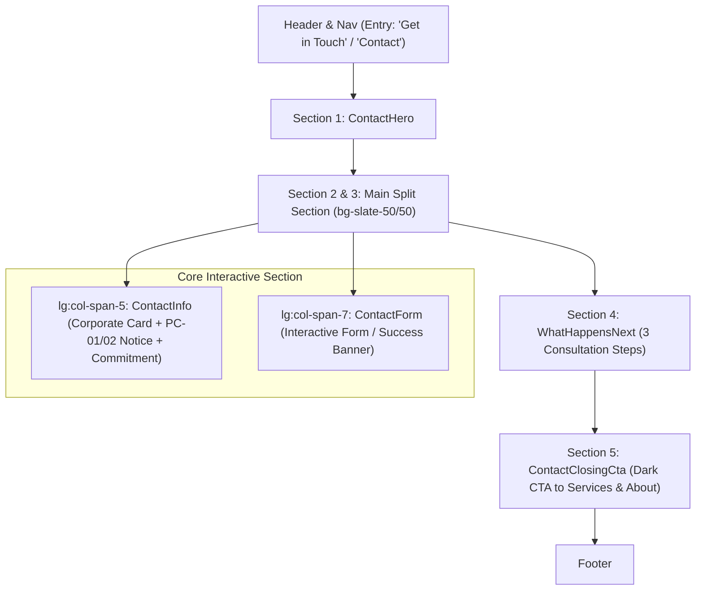

# TASK 19 AUDIT REPORT — CONTACT PAGE & CONTACT FORM UX
## PHASE 02 — CONTACT REFINEMENT

- **Project:** BIZWORK-IT Website Redesign
- **Workspace:** `D:\job\1_bizwork-redesign`
- **Phase:** 02 — Contact Refinement
- **Task:** 19 — Contact Page & Form UX Refinement
- **Audit Date:** 2026-11-18
- **Latest Accepted Git Commit:** `e188a29`
- **Execution Mode:** AUDIT ONLY (No source code modifications)
- **Status:** WAITING APPROVAL

---

## 1. EXECUTIVE SUMMARY

An exhaustive UI/UX, accessibility (WCAG 2.2), responsive, and bilingual audit was conducted for the Contact page (`/contact`) and its interactive contact form components across the BIZWORK-IT website.

The Contact page currently serves as the primary commercial conversion destination across all page CTA entry points. In accordance with project governance (Tasks 02, 13, and 18), the form functions as a verified client-side demonstration with strict client-side validation, transparent demo notices, and pending credentials (`PC-01` phone, `PC-02` address).

While the visual design successfully adheres to the Modern Tech Enterprise direction (clean typography, subtle borders, high contrast), the audit identified **14 specific issues** across usability, accessibility, keyboard navigation, focus management, mobile Safari input behavior, semantic HTML landmarks, and content clarity:
- **Critical:** 0 issues
- **High:** 2 issues (Focus loss on form submission/reset, missing auto-focus on first invalid field upon submit)
- **Medium:** 4 issues (WCAG 1.4.3 contrast failure on `(Optional)` label, iOS Safari auto-zoom on form inputs, non-semantic section container, missing micro-interaction submission state)
- **Low:** 7 issues (WCAG contrast on required asterisks, unannounced error icon symbol, heading hierarchy inconsistency in `ContactInfo`, missing message character counter, internal sprint task reference in client copy, redundant footer note repetition, Hero button focus handoff)
- **Observation:** 1 issue (Direct native `<button>` element usage vs shared `<Button>` component)

---

## 2. SCOPE & FILES INSPECTED

The audit evaluated all components, styles, dictionaries, and navigation entry points related to the Contact page:

| Category | File Path | Role in Contact Experience |
| :--- | :--- | :--- |
| **Page Route** | [app/contact/page.tsx](file:///d:/job/1_bizwork-redesign/app/contact/page.tsx) | Page layout, metadata, section composition |
| **Component** | [components/contact/ContactHero.tsx](file:///d:/job/1_bizwork-redesign/components/contact/ContactHero.tsx) | Hero banner, breadcrumbs, title, dual CTAs |
| **Component** | [components/contact/ContactInfo.tsx](file:///d:/job/1_bizwork-redesign/components/contact/ContactInfo.tsx) | Corporate entity card, pending notice card (`PC-01`/`PC-02`), service commitment |
| **Component** | [components/contact/ContactForm.tsx](file:///d:/job/1_bizwork-redesign/components/contact/ContactForm.tsx) | Interactive form, validation state, error handling, success confirmation banner |
| **Component** | [components/contact/WhatHappensNext.tsx](file:///d:/job/1_bizwork-redesign/components/contact/WhatHappensNext.tsx) | 3-step consultation workflow process cards |
| **Component** | [components/contact/ContactClosingCta.tsx](file:///d:/job/1_bizwork-redesign/components/contact/ContactClosingCta.tsx) | Dark closing CTA section routing to Services & About |
| **Barrel Export** | [components/contact/index.ts](file:///d:/job/1_bizwork-redesign/components/contact/index.ts) | Public component export interface |
| **Shared UI** | [components/common/Button.tsx](file:///d:/job/1_bizwork-redesign/components/common/Button.tsx) | Shared button styles, variants, touch targets |
| **Shared UI** | [components/common/Container.tsx](file:///d:/job/1_bizwork-redesign/components/common/Container.tsx) | Max-width container wrapper |
| **Shared UI** | [components/common/SectionHeader.tsx](file:///d:/job/1_bizwork-redesign/components/common/SectionHeader.tsx) | Shared section headers |
| **i18n** | [lib/i18n/dictionaries/en.ts](file:///d:/job/1_bizwork-redesign/lib/i18n/dictionaries/en.ts) | English translation dictionary (74 contact keys) |
| **i18n** | [lib/i18n/dictionaries/vi.ts](file:///d:/job/1_bizwork-redesign/lib/i18n/dictionaries/vi.ts) | Vietnamese translation dictionary (74 contact keys) |
| **i18n** | [lib/i18n/types.ts](file:///d:/job/1_bizwork-redesign/lib/i18n/types.ts) | TypeScript translation definitions |
| **i18n** | [lib/i18n/LanguageContext.tsx](file:///d:/job/1_bizwork-redesign/lib/i18n/LanguageContext.tsx) | Dynamic document title synchronization for `/contact` |
| **Styles** | [app/globals.css](file:///d:/job/1_bizwork-redesign/app/globals.css) | Global theme variables, smooth scrolling |
| **Navigation** | [components/common/Header.tsx](file:///d:/job/1_bizwork-redesign/components/common/Header.tsx) | Header nav link and "Get in Touch" CTA button |
| **Navigation** | [components/common/Footer.tsx](file:///d:/job/1_bizwork-redesign/components/common/Footer.tsx) | Footer nav link and CTA button |

---

## 3. CURRENT CONTACT PAGE STRUCTURE & USER FLOW

The Contact page is structured into five distinct vertical sections:

### Conversion Flow Analysis:
1. **Entry:** Users enter `/contact` via the header navigation, header primary CTA ("Get in Touch"), footer CTA, or page-level closing CTAs from `/`, `/about`, and `/services`.
2. **Hero:** `ContactHero` provides an immediate primary button (`"Jump to Contact Form ↓"`) anchored to `#contact-form` and a secondary button leading to `/services`.
3. **Information & Action:**
   - Desktop ($\ge 1024$px): Side-by-side presentation (5 cols info, 7 cols form).
   - Mobile & Tablet ($< 1024$px): Stacks `ContactInfo` above `ContactForm`. Users must scroll past 3 large cards before reaching the first form input.
4. **Post-Submission:** Submitting the form replaces the form with a polite confirmation status banner acknowledging valid client-side validation and explaining pending backend dispatch.
5. **Reassurance & Follow-Through:** `WhatHappensNext` sets expectations on the 3-step consultation process.
6. **Next Steps:** `ContactClosingCta` gives users who reached the end of the page pathways to explore Services or read About BIZWORK-IT.

---

## 4. DETAILED AUDIT FINDINGS

### 4.1 Accessibility & Focus Management Findings

#### ISSUE-19-01: Focus Loss on Form Submission and Reset
- **Severity:** High
- **Category:** WCAG 2.2 SC 2.4.3 (Focus Order) & Usability
- **File:** [components/contact/ContactForm.tsx#L162-L211](file:///d:/job/1_bizwork-redesign/components/contact/ContactForm.tsx#L162-L211)
- **Current Behavior:** When the user clicks the submit button and validation succeeds, `setValidationSuccess(true)` unmounts the `<form>` element entirely and mounts the confirmation banner (`role="status"`). The submit button that held user DOM focus is removed from the DOM. Consequently, the browser resets focus to `document.body` (the top of the page). Similarly, clicking the "Reset Form to Test Again" button unmounts the confirmation banner, dropping focus back to `<body>`.
- **Impact:** Screen reader and keyboard users are abruptly disoriented and thrown to the top of the webpage, losing their context entirely.
- **Remediation:** Implement a container `ref` with `tabIndex={-1}` on the confirmation banner. Upon successful validation, programmatically move focus to the banner header. Upon reset, programmatically move focus back to the `fullName` input.

#### ISSUE-19-02: Missing Focus on First Invalid Field on Failed Submission
- **Severity:** High
- **Category:** WCAG 2.2 SC 3.3.1 (Error Identification) & Form Usability
- **File:** [components/contact/ContactForm.tsx#L106-L135](file:///d:/job/1_bizwork-redesign/components/contact/ContactForm.tsx#L106-L135)
- **Current Behavior:** When the user clicks "Validate & Submit Inquiry" with missing or invalid fields, `handleSubmit` populates `newErrors`. The error messages render below each invalid input. However, active DOM focus remains stuck on the submit button at the bottom of the form.
- **Impact:** On mobile screens, the submit button is positioned below the viewport fold relative to the top fields. When tapping Submit, the page does not scroll or focus on the error. To the user, it appears as though nothing happened. Screen reader users do not receive immediate focus navigation to rectify the mistake.
- **Remediation:** When `Object.keys(newErrors).length > 0`, query the first failing field (`fullName`, `email`, or `message`) and call `.focus()` on its DOM input.

#### ISSUE-19-03: Low Contrast on Optional Label `(Optional)` / `(Tùy chọn)`
- **Severity:** Medium
- **Category:** WCAG 2.2 SC 1.4.3 (Contrast Minimum - Level AA Failure)
- **File:** [components/contact/ContactForm.tsx#L292](file:///d:/job/1_bizwork-redesign/components/contact/ContactForm.tsx#L292)
- **Current Behavior:** The Company Name label uses `{formText.labelCompanyOptional}`.
- **Calculated Evidence (Standard sRGB Relative Luminance):**
  - Text color: `text-slate-400` (`#94A3B8`, RGB: 148, 163, 184)
  - Background: `#FFFFFF` (RGB: 255, 255, 255)
  - $R_{\text{lin}} = ((148/255 + 0.055) / 1.055)^{2.4} = 0.29614$
  - $G_{\text{lin}} = ((163/255 + 0.055) / 1.055)^{2.4} = 0.36632$
  - $B_{\text{lin}} = ((184/255 + 0.055) / 1.055)^{2.4} = 0.47649$
  - Relative Luminance $L_1 = 0.2126 \times 0.29614 + 0.7152 \times 0.36632 + 0.0722 \times 0.47649 = 0.35951$
  - Background Luminance $L_2 = 1.00000$
  - **Exact Contrast Ratio:** $(1.00000 + 0.05) / (0.35951 + 0.05) = 1.05 / 0.40951 = \mathbf{2.56:1}$.
  - **WCAG Requirement:** Minimum $4.5:1$ for normal text ($< 18$pt / $< 14$pt bold).
  - **Status:** **FAIL**. The text fails the WCAG AA minimum threshold ($2.56:1 < 4.5:1$).
- **Remediation:** Update `text-slate-400` to `text-slate-500` (`#64748B`, $L = 0.17064$, contrast **$4.76:1$**, PASS AA) or `text-slate-600` (`#475569`, $L = 0.08857$, contrast **$7.58:1$**, PASS AAA).

#### ISSUE-19-04: Low Contrast on Required Asterisk Markers
- **Severity:** Low
- **Category:** WCAG 2.2 SC 1.4.3 (Contrast Minimum)
- **File:** [components/contact/ContactForm.tsx#L221](file:///d:/job/1_bizwork-redesign/components/contact/ContactForm.tsx#L221), [#L255](file:///d:/job/1_bizwork-redesign/components/contact/ContactForm.tsx#L255), [#L343](file:///d:/job/1_bizwork-redesign/components/contact/ContactForm.tsx#L343)
- **Current Behavior:** Required field asterisks use `*`.
- **Calculated Evidence (Standard sRGB Relative Luminance):**
  - Text color: `text-red-500` (`#EF4444`, RGB: 239, 68, 68)
  - Relative Luminance $L_1 = 0.22902$
  - Background Luminance $L_2 = 1.00000$
  - **Exact Contrast Ratio:** $(1.00000 + 0.05) / (0.22902 + 0.05) = 1.05 / 0.27902 = \mathbf{3.76:1}$.
  - **Status:** Below $4.5:1$ (Level AA Fail).
- **Remediation:** Change to `text-red-600` (`#DC2626`, $L = 0.16742$, contrast **$4.83:1$**, PASS AA), matching the error text color used in the form.

#### ISSUE-19-06: Unannounced Error Symbol `⚠`
- **Severity:** Low
- **Category:** Screen Reader Usability & ARIA
- **File:** [components/contact/ContactForm.tsx#L243](file:///d:/job/1_bizwork-redesign/components/contact/ContactForm.tsx#L243), [#L277](file:///d:/job/1_bizwork-redesign/components/contact/ContactForm.tsx#L277), [#L364](file:///d:/job/1_bizwork-redesign/components/contact/ContactForm.tsx#L364)
- **Current Behavior:** Error messages render `⚠ {formText[errors.fieldName]}` without hiding the unicode symbol from assistive technology.
- **Impact:** Screen readers vocalize "warning sign" or unicode code point before reading the localized error string.
- **Remediation:** Add `aria-hidden="true"` to `⚠` or replace with an accessible inline SVG icon with `aria-hidden="true"`.

#### ISSUE-19-13: Incomplete Focus Handoff on Hero Anchor Link
- **Severity:** Low
- **Category:** Keyboard Navigation & Focus Flow
- **File:** [components/contact/ContactHero.tsx#L65](file:///d:/job/1_bizwork-redesign/components/contact/ContactHero.tsx#L65) & [components/contact/ContactForm.tsx#L146](file:///d:/job/1_bizwork-redesign/components/contact/ContactForm.tsx#L146)
- **Current Behavior:** The primary button in `ContactHero` has `href="#contact-form"`. Activating it scrolls the browser viewport to `id="contact-form"`. However, because `id="contact-form"` is a non-focusable `
` without a `tabIndex`, DOM keyboard focus remains on the Hero button.
- **Impact:** Pressing Tab after clicking "Jump to Contact Form" continues keyboard traversal inside the Hero section rather than entering the form fields.
- **Remediation:** Add `tabIndex={-1}` and `className="focus:outline-none"` to `#contact-form` so that keyboard navigation logically continues into the form.

---

### 4.2 Mobile & Responsive Usability Findings

#### ISSUE-19-05: iOS Safari Auto-Zoom on Form Inputs (`text-sm` vs `text-base`)
- **Severity:** Medium
- **Category:** Mobile Safari Ergonomics
- **File:** [components/contact/ContactForm.tsx#L235](file:///d:/job/1_bizwork-redesign/components/contact/ContactForm.tsx#L235), [#L269](file:///d:/job/1_bizwork-redesign/components/contact/ContactForm.tsx#L269), [#L302](file:///d:/job/1_bizwork-redesign/components/contact/ContactForm.tsx#L302), [#L320](file:///d:/job/1_bizwork-redesign/components/contact/ContactForm.tsx#L320), [#L356](file:///d:/job/1_bizwork-redesign/components/contact/ContactForm.tsx#L356)
- **Current Behavior:** Inputs, selects, and textareas use `text-sm` ($14$px).
- **Impact:** iOS Safari triggers an involuntary viewport auto-zoom when focusing any input with font size $< 16$px. This clips margins and forces mobile users to manually pinch-zoom out after typing.
- **Remediation:** Update input classes to `text-base sm:text-sm`. On mobile screens ($< 640$px), font size is $16$px (preventing auto-zoom), while on tablet and desktop ($\ge 640$px) it seamlessly scales to $14$px for refined enterprise density.

---

### 4.3 Semantic HTML & Architecture Findings

#### ISSUE-19-07: Main Contact Section Rendered as Generic Non-Semantic `
`
- **Severity:** Medium
- **Category:** HTML5 Semantic Structure & Landmark Accessibility
- **File:** [app/contact/page.tsx#L24](file:///d:/job/1_bizwork-redesign/app/contact/page.tsx#L24)
- **Current Behavior:** The core section containing `ContactInfo` and `ContactForm` is rendered as `
` with no landmark role or label.
- **Impact:** Screen reader landmark navigation recognizes `ContactHero`, `WhatHappensNext`, and `ContactClosingCta`, but bypasses the most critical section on the entire page.
- **Remediation:** Change outer wrapper from `
` to `<section aria-labelledby="contact-portal-heading">` (or `<section aria-label="...">`) to establish an explicit landmark.

#### ISSUE-19-08: Heading Hierarchy Inconsistency in `ContactInfo.tsx`
- **Severity:** Low
- **Category:** WCAG 2.2 SC 1.3.1 (Info and Relationships)
- **File:** [components/contact/ContactInfo.tsx#L33](file:///d:/job/1_bizwork-redesign/components/contact/ContactInfo.tsx#L33), [#L94](file:///d:/job/1_bizwork-redesign/components/contact/ContactInfo.tsx#L94), [#L116](file:///d:/job/1_bizwork-redesign/components/contact/ContactInfo.tsx#L116)
- **Current Behavior:**
  - Card 1 uses `
{info.cardTitle}
`.
  - Card 2 uses `<h3 className="text-xs font-bold uppercase tracking-wider text-slate-700">{info.inviteHeading}</h3>`.
  - Card 3 uses `<h4 className="text-xs font-bold uppercase tracking-wider text-blue-900">{info.commitmentTitle}</h4>`.
- **Impact:** Skips heading level `<h2>`, while Card 3 jumps to `<h4>` without an enclosing `<h3>`, producing an erratic heading outline.
- **Remediation:** Standardize card headings to `<h3>` consistently across all three info cards.

#### ISSUE-19-14: Direct Native `<button>` Usage Bypassing Shared `<Button>`
- **Severity:** Observation
- **Category:** Component Consistency & Design System
- **File:** [components/contact/ContactForm.tsx#L377-L384](file:///d:/job/1_bizwork-redesign/components/contact/ContactForm.tsx#L377-L384)
- **Current Behavior:** The submit button is implemented as a native `<button>` with raw Tailwind utility classes, whereas the Reset button on line 201 uses `<Button variant="primary" size="sm">`.
- **Remediation:** Refactor the submit button to use `<Button variant="primary" size="lg" type="submit">`, ensuring centralized focus-ring, transition, and active-state styling from `Button.tsx`.

---

### 4.4 Form Usability & Micro-Interactions

#### ISSUE-19-09: Missing Micro-Interaction & Submission State Feedback
- **Severity:** Medium
- **Category:** User Feedback & Interaction Ergonomics
- **File:** [components/contact/ContactForm.tsx#L106-L135](file:///d:/job/1_bizwork-redesign/components/contact/ContactForm.tsx#L106-L135)
- **Current Behavior:** Clicking submit immediately switches the view to the success banner with 0ms delay.
- **Impact:** An instantaneous swap feels jarring and mechanical. Users cannot perceive that verification was executed. Furthermore, rapid double-clicking during validation can produce glitchy state transitions.
- **Remediation:** Introduce a brief, smooth validation state (`isValidating` or `isSubmitting`, e.g., 400ms duration) with a subtle spinner or disabled button state before revealing the confirmation banner.

#### ISSUE-19-10: Missing Message Requirement Helper Text / Live Character Counter
- **Severity:** Low
- **Category:** Form Usability & Error Prevention
- **File:** [components/contact/ContactForm.tsx#L338-L368](file:///d:/job/1_bizwork-redesign/components/contact/ContactForm.tsx#L338-L368)
- **Current Behavior:** The `message` field enforces a 10-character minimum (`errorMessageLength`), but does not display any helper text or character counter prior to submission.
- **Impact:** Users typing short queries only discover the requirement after triggering an error.
- **Remediation:** Add subtle helper text below the textarea (e.g., "Minimum 10 characters") or a live character counter (`X / 10 min characters`).

---

### 4.5 Content, Bilingual & Enterprise Tone Findings

#### ISSUE-19-11: Internal Sprint Task Reference Exposed in Public UI Copy
- **Severity:** Low
- **Category:** Enterprise Brand Professionalism & Copy Refinement
- **Files:** [lib/i18n/dictionaries/en.ts#L517](file:///d:/job/1_bizwork-redesign/lib/i18n/dictionaries/en.ts#L517), [lib/i18n/dictionaries/vi.ts#L517](file:///d:/job/1_bizwork-redesign/lib/i18n/dictionaries/vi.ts#L517)
- **Current Text (EN):** `"In accordance with project scope (Task 13: UI & Client Validation Only), live email dispatch and database integration are scheduled for a future backend phase..."`
- **Current Text (VI):** `"Theo đúng phạm vi kỹ thuật của dự án (Task 13: Giao diện & Kiểm tra Client), chức năng gửi email trực tiếp và cơ sở dữ liệu sẽ được kết nối ở giai đoạn sau..."`
- **Impact:** Exposing internal development sprint labels (`Task 13`) in customer-facing UI detracts from enterprise credibility.
- **Remediation:** Remove `"(Task 13: UI & Client Validation Only)"` entirely and refine to truthful, professional copy:
  - **EN:** `"This form currently performs frontend validation checks only. Direct email dispatch and database storage are pending future backend integration. No customer data has been stored, saved, or transmitted over the network."`
  - **VI:** `"Biểu mẫu này hiện chỉ thực hiện kiểm tra tính hợp lệ của dữ liệu ở phía giao diện (client-side). Chức năng gửi email trực tiếp và lưu trữ cơ sở dữ liệu đang chờ tích hợp backend ở giai đoạn sau. Không có dữ liệu khách hàng nào được lưu trữ hoặc truyền qua mạng."`

#### ISSUE-19-12: Redundant Note Repetition in `WhatHappensNext.tsx`
- **Severity:** Low
- **Category:** Content Redundancy & Card Layout
- **File:** [components/contact/WhatHappensNext.tsx#L116-L120](file:///d:/job/1_bizwork-redesign/components/contact/WhatHappensNext.tsx#L116-L120)
- **Current Behavior:** All three cards display an identical footer note: `"{data.footerNote}"` (`"Tailored specifically for SMBs in Singapore"` / `"Được may đo riêng cho các doanh nghiệp SMBs tại Singapore"`).
- **Impact:** Reading the exact same sentence three times side by side across a 3-column grid creates visual and editorial repetition.
- **Remediation:** Either display the footer note once centrally below the 3-column card grid or assign contextual per-step notes.

---

## 5. FINDINGS BY SEVERITY SUMMARY

| Severity | Count | Issue Identifiers | Primary Focus Area |
| :---: | :---: | :--- | :--- |
| **Critical** | **0** | — | No blocking crashes or severe breaking defects |
| **High** | **2** | `ISSUE-19-01`, `ISSUE-19-02` | Focus order, focus loss prevention, error field auto-focus |
| **Medium** | **4** | `ISSUE-19-03`, `ISSUE-19-05`, `ISSUE-19-07`, `ISSUE-19-09` | WCAG 1.4.3 contrast, iOS auto-zoom, semantic section, micro-interaction |
| **Low** | **7** | `ISSUE-19-04`, `ISSUE-19-06`, `ISSUE-19-08`, `ISSUE-19-10`, `ISSUE-19-11`, `ISSUE-19-12`, `ISSUE-19-13` | Asterisk contrast, error icon ARIA, heading hierarchy, character hint, sprint copy, note repetition, anchor focus |
| **Observation**| **1** | `ISSUE-19-14` | Shared `Button` component unification |
| **Total** | **14** | | |

---

## 6. VERIFICATION LIMITATIONS & CONSTRAINTS

1. **Frontend Demonstration Constraint:** In strict adherence to project scope, the contact form remains a frontend client demonstration. No real backend endpoints, SMTP relays, CRM integrations, or database mutations are introduced.
2. **Pending Corporate Credentials (`PC-01`, `PC-02`):** The transparent notice regarding pending phone numbers and street address is preserved as required by project governance.
3. **Audit Execution Boundary:** No source code, translation dictionaries, or styles have been altered during this audit step. Working tree changes from Task 18 remain intact.

---

## 7. AUDIT CONCLUSION & NEXT STEP

The audit confirms that the Contact page has a solid functional and visual foundation, but requires controlled refinements in focus management, contrast compliance, mobile Safari ergonomics, and semantic structure to achieve full enterprise grade.

The complete prioritized remediation plan is detailed in [docs/TASK_19_IMPLEMENTATION_PLAN.md](file:///d:/job/1_bizwork-redesign/docs/TASK_19_IMPLEMENTATION_PLAN.md).
