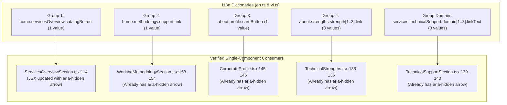

# TASK 21 — TYPOGRAPHY, CARDS & COMPONENTS REFINEMENT IMPLEMENTATION PLAN
**Visual Consistency Phase (Phase 03 — Task 21) — Revision 1**

- **Project:** BIZWORK-IT Website Redesign
- **Workspace:** `D:\job\1_bizwork-redesign`
- **Current Status:** `PLANNING REVISED (REVISION 1) — AWAITING CODING AUTHORIZATION`
- **Execution Mode:** IMPLEMENTATION PLAN ONLY (Coding Strictly Prohibited until Approved)
- **Baseline Commit:** `e188a29` (Task 17 accepted commit)

---

## REVISION NOTE (REVISION 1)

This revision incorporates the two mandatory corrections requested by the Project Owner:

1. **Clarification of Translation Dictionary Mapping:**
   - Clarified that the double-arrow remediation encompasses **5 key groups** comprising **9 individual string values** in each dictionary (18 translated values total across `en.ts` and `vi.ts`).
   - Conducted a repository-wide usage audit documenting every component consumer for all 9 string values, verifying that removing the trailing arrow will not break or strip arrows from any other component.
2. **Correction of Arrow Verification Criteria:**
   - Replaced the global zero-arrow dictionary constraint with targeted verification criteria:
     - Verify only the 9 approved target string values in each dictionary.
     - Confirm those 9 target values no longer contain a trailing arrow `" →"`.
     - Preserve any unrelated legitimate arrow characters elsewhere.
     - Confirm all 5 affected interactive areas render exactly one visual arrow.
     - Confirm all decorative visual arrows use `aria-hidden="true"` where appropriate.

---

## 1. OBJECTIVE & SCOPE DEFINITION

This implementation plan details the precise, surgical modifications required to resolve the defects and inconsistencies identified in `docs/TASK_21_AUDIT_REPORT.md`:

1. **Eliminate Double Arrow Rendering (ISSUE-21-01):**
   Remove trailing `" →"` from 5 translation key groups (9 individual string values per dictionary) in `lib/i18n/dictionaries/en.ts` and `lib/i18n/dictionaries/vi.ts`. Standardize `ServicesOverviewSection.tsx` to render `<span aria-hidden="true" className="ml-1.5">→</span>`.
2. **Harmonize 3-Column Card Resting State & Borders (ISSUE-21-02):**
   Add `shadow-xs` and standardize border tokens in `components/home/ValuePillarsSection.tsx` to match `TechnicalStrengths`, `TechnicalSupportSection`, and `WhatHappensNext`.
3. **Harmonize Feature Card Divider Spacing (ISSUE-21-03):**
   Standardize internal divider padding in `components/home/ValuePillarsSection.tsx` from `pt-5` to `pt-4`.
4. **Harmonize Corporate Registration Card Styling (ISSUE-21-04):**
   Normalize Verified badge padding to `px-2.5` and location font size to `text-sm font-semibold text-slate-800` in `components/about/CorporateProfile.tsx` to match `ContactInfo.tsx`.

### Core Architectural Constraints:
- **Zero New Dependencies:** No external libraries, icon sets, or fonts will be installed.
- **Strict Scope Preservation:** Zero modifications to Tasks 18, 19, and 20 accepted behaviors (404 bilingual hydration, contact form validation/focus, section spacing).
- **Zero Copy Changes:** Translation copy remains semantically identical; only raw Unicode trailing arrows are cleaned from dictionaries.
- **Type Safety:** No changes to `lib/i18n/types.ts` (all keys remain `string`).

---

## 2. AUTHORIZED FILE LIST

Exactly **5 files** are authorized for modification upon approval:

1. `lib/i18n/dictionaries/en.ts` (Remove trailing `" →"` from 9 string values across 5 key groups)
2. `lib/i18n/dictionaries/vi.ts` (Remove trailing `" →"` from 9 string values across 5 key groups)
3. `components/home/ServicesOverviewSection.tsx` (Catalog button arrow markup)
4. `components/home/ValuePillarsSection.tsx` (Card container shadow/border and divider padding)
5. `components/about/CorporateProfile.tsx` (Verified badge padding and location font size)

*No other application source files or configuration files may be modified.*

---

## 3. TRANSLATION DICTIONARY MAPPING & REPOSITORY-WIDE USAGE AUDIT

The dictionary remediation targets **5 key groups** containing **9 individual translated values per language** (18 string values total). A repository-wide usage search was executed to trace every consumer of these values:



### Detailed Key Consumer Verification Table

| # | Key Group & Dictionary Path | Values per Dict | Component Consumer (File & Lines) | Existing JSX Arrow Handling | Impact of Removing Trailing Arrow | Other Consumers in Repo |
| :-: | :--- | :-: | :--- | :--- | :--- | :-: |
| **1** | `home.servicesOverview.catalogButton` | 1 | `components/home/ServicesOverviewSection.tsx:114` | Currently `{data.catalogButton} →` | STEP 3 updates JSX to `{data.catalogButton} <span aria-hidden="true" className="ml-1.5">→</span>`. Result: exactly 1 arrow. | None |
| **2** | `home.methodology.supportLink` | 1 | `components/home/WorkingMethodologySection.tsx:153-154` | Line 154 already contains `<span aria-hidden="true">→</span>` | Trailing arrow removed from text; line 154 renders exactly 1 arrow. | None |
| **3** | `about.profile.cardButton` | 1 | `components/about/CorporateProfile.tsx:145-146` | Line 146 already contains `<span aria-hidden="true">→</span>` | Trailing arrow removed from text; line 146 renders exactly 1 arrow. | None |
| **4** | `about.strengths.strength[1,2,3].link` | 3 | `components/about/TechnicalStrengths.tsx:135-136` | Line 136 already contains `<span aria-hidden="true">→</span>` | Trailing arrow removed from text; line 136 renders exactly 1 arrow across all 3 cards. | None |
| **5** | `services.technicalSupport.domain[1,2,3].linkText` | 3 | `components/services/TechnicalSupportSection.tsx:139-140` | Line 140 already contains `<span aria-hidden="true">→</span>` | Trailing arrow removed from text; line 140 renders exactly 1 arrow across all 3 cards. | None* |

*\*Note on `linkText`: Other dictionary objects (`home.pillars.pillar[].linkText` and `home.servicesOverview.groups[].linkText`) also use the property name `linkText`, but those objects never contained trailing arrows and are consumed by `ValuePillarsSection` and `ServicesOverviewSection` respectively. They remain completely untouched.*

**Confirmation:** Every one of the 9 string values is consumed exclusively by a component that explicitly provides its own arrow in JSX. Therefore, removing the trailing arrow from these 9 values will eliminate duplicate arrows without breaking or stripping arrows from any component in the repository.

---

## 4. PROPOSED IMPLEMENTATION SEQUENCE & CODE SPECIFICATIONS

### STEP 1: Purge Baked-In Arrows from English Dictionary (ISSUE-21-01)
- **File:** `lib/i18n/dictionaries/en.ts`
- **Group 1 (Line 109 — 1 value):** `home.servicesOverview.catalogButton`
  - Target: `catalogButton: "View Complete Services Breakdown →",`
  - Replacement: `catalogButton: "View Complete Services Breakdown",`
- **Group 2 (Line 145 — 1 value):** `home.methodology.supportLink`
  - Target: `supportLink: "Learn more about our corporate background and service philosophy →",`
  - Replacement: `supportLink: "Learn more about our corporate background and service philosophy",`
- **Group 3 (Line 226 — 1 value):** `about.profile.cardButton`
  - Target: `cardButton: "Connect With Our Team via Contact →",`
  - Replacement: `cardButton: "Connect With Our Team via Contact",`
- **Group 4 (Lines 263, 275, 287 — 3 values):** `about.strengths.strength[1,2,3].link`
  - Target (Line 263): `link: "Discover our services in detail →",`
  - Replacement (Line 263): `link: "Discover our services in detail",`
  - Target (Line 275): `link: "Discover our services in detail →",`
  - Replacement (Line 275): `link: "Discover our services in detail",`
  - Target (Line 287): `link: "Discover our services in detail →",`
  - Replacement (Line 287): `link: "Discover our services in detail",`
- **Group 5 (Lines 338, 350, 362 — 3 values):** `services.technicalSupport.domain[1,2,3].linkText`
  - Target (Line 338): `linkText: "Inquire about this support scope →",`
  - Replacement (Line 338): `linkText: "Inquire about this support scope",`
  - Target (Line 350): `linkText: "Inquire about this support scope →",`
  - Replacement (Line 350): `linkText: "Inquire about this support scope",`
  - Target (Line 362): `linkText: "Inquire about this support scope →",`
  - Replacement (Line 362): `linkText: "Inquire about this support scope",`

---

### STEP 2: Purge Baked-In Arrows from Vietnamese Dictionary (ISSUE-21-01)
- **File:** `lib/i18n/dictionaries/vi.ts`
- **Group 1 (Line 109 — 1 value):** `home.servicesOverview.catalogButton`
  - Target: `catalogButton: "Xem Toàn bộ Danh mục Dịch vụ →",`
  - Replacement: `catalogButton: "Xem Toàn bộ Danh mục Dịch vụ",`
- **Group 2 (Line 145 — 1 value):** `home.methodology.supportLink`
  - Target: `supportLink: "Tìm hiểu thêm về hồ sơ doanh nghiệp và triết lý dịch vụ của chúng tôi →",`
  - Replacement: `supportLink: "Tìm hiểu thêm về hồ sơ doanh nghiệp và triết lý dịch vụ của chúng tôi",`
- **Group 3 (Line 226 — 1 value):** `about.profile.cardButton`
  - Target: `cardButton: "Kết nối với Đội ngũ qua Liên hệ →",`
  - Replacement: `cardButton: "Kết nối với Đội ngũ qua Liên hệ",`
- **Group 4 (Lines 263, 275, 287 — 3 values):** `about.strengths.strength[1,2,3].link`
  - Target (Line 263): `link: "Tìm hiểu chi tiết các dịch vụ của chúng tôi →",`
  - Replacement (Line 263): `link: "Tìm hiểu chi tiết các dịch vụ của chúng tôi",`
  - Target (Line 275): `link: "Tìm hiểu chi tiết các dịch vụ của chúng tôi →",`
  - Replacement (Line 275): `link: "Tìm hiểu chi tiết các dịch vụ của chúng tôi",`
  - Target (Line 287): `link: "Tìm hiểu chi tiết các dịch vụ của chúng tôi →",`
  - Replacement (Line 287): `link: "Tìm hiểu chi tiết các dịch vụ của chúng tôi",`
- **Group 5 (Lines 338, 350, 362 — 3 values):** `services.technicalSupport.domain[1,2,3].linkText`
  - Target (Line 338): `linkText: "Trao đổi về phạm vi hỗ trợ này →",`
  - Replacement (Line 338): `linkText: "Trao đổi về phạm vi hỗ trợ này",`
  - Target (Line 350): `linkText: "Trao đổi về phạm vi hỗ trợ này →",`
  - Replacement (Line 350): `linkText: "Trao đổi về phạm vi hỗ trợ này",`
  - Target (Line 362): `linkText: "Trao đổi về phạm vi hỗ trợ này →",`
  - Replacement (Line 362): `linkText: "Trao đổi về phạm vi hỗ trợ này",`

---

### STEP 3: Normalize Catalog Button Arrow in ServicesOverviewSection (ISSUE-21-01)
- **File:** `components/home/ServicesOverviewSection.tsx`
- **Line:** 114
- **Target Code:**
  ```tsx
  <Button href="/services" variant="secondary" size="md">
    {data.catalogButton} →
  </Button>
  ```
- **Replacement Code:**
  ```tsx
  <Button href="/services" variant="secondary" size="md">
    <span>{data.catalogButton}</span>
    <span aria-hidden="true" className="ml-1.5">→</span>
  </Button>
  ```
- **Expected Outcome:** Renders exactly one arrow masked with `aria-hidden="true"`, matching the button layout across the rest of the site.

---

### STEP 4: Standardize Card Shadow, Border & Divider Spacing in ValuePillarsSection (ISSUE-21-02 & ISSUE-21-03)
- **File:** `components/home/ValuePillarsSection.tsx`
- **Lines 99 & 126:**
- **Target Code (Line 99):**
  ```tsx
  className="group relative flex flex-col justify-between rounded-2xl border border-slate-200/90 bg-slate-50/50 p-7 transition-all duration-300 hover:-translate-y-1 hover:border-blue-400/60 hover:bg-white hover:shadow-lg hover:shadow-blue-500/5"
  ```
- **Replacement Code (Line 99):**
  ```tsx
  className="group relative flex flex-col justify-between rounded-2xl border border-slate-200 bg-slate-50/50 p-7 shadow-xs transition-all duration-300 hover:-translate-y-1 hover:border-blue-400/50 hover:bg-white hover:shadow-lg hover:shadow-blue-500/5"
  ```
- **Target Code (Line 126):**
  ```tsx
  <div className="mt-6 pt-5 border-t border-slate-200/60">
  ```
- **Replacement Code (Line 126):**
  ```tsx
  <div className="mt-6 pt-4 border-t border-slate-200/60">
  ```
- **Expected Outcome:** `ValuePillarsSection` cards gain `shadow-xs` in initial resting state, borders align with `border-slate-200` and `hover:border-blue-400/50`, and divider padding aligns to `pt-4`, achieving 100% parity with `TechnicalStrengths` and `TechnicalSupportSection`.

---

### STEP 5: Standardize Corporate Registration Card Verified Badge & Location (ISSUE-21-04)
- **File:** `components/about/CorporateProfile.tsx`
- **Lines 97 & 119:**
- **Target Code (Line 97):**
  ```tsx
  <span className="inline-flex items-center rounded-full bg-emerald-50 px-2 py-0.5 text-[10px] font-bold text-emerald-700 ring-1 ring-inset ring-emerald-600/20">
    {profile.verifiedBadge}
  </span>
  ```
- **Replacement Code (Line 97):**
  ```tsx
  <span className="inline-flex items-center rounded-full bg-emerald-50 px-2.5 py-0.5 text-[10px] font-bold text-emerald-700 ring-1 ring-inset ring-emerald-600/20">
    {profile.verifiedBadge}
  </span>
  ```
- **Target Code (Line 119):**
  ```tsx
  <p className="mt-0.5 text-xs font-semibold text-slate-800 flex items-center gap-1.5">
    <span className="h-2 w-2 rounded-full bg-emerald-500" aria-hidden="true" />
    {profile.locationValue}
  </p>
  ```
- **Replacement Code (Line 119):**
  ```tsx
  <p className="mt-0.5 text-sm font-semibold text-slate-800 flex items-center gap-1.5">
    <span className="h-2 w-2 rounded-full bg-emerald-500" aria-hidden="true" />
    {profile.locationValue}
  </p>
  ```
- **Expected Outcome:** Badge padding expands from `px-2` to `px-2.5`, and location value font size normalizes to `text-sm`, matching `ContactInfo.tsx`.

---

## 5. VERIFICATION PLAN & COMMAND MATRIX

Once authorized and implemented, the following verification commands will be executed:

| Step | Verification Area | Target / Pass Criteria |
| :---: | :--- | :--- |
| **1** | TypeScript compilation | `npx tsc --noEmit` exits with code 0, zero TypeScript errors. |
| **2** | ESLint static analysis | `npm run lint` exits with code 0, zero warnings or errors. |
| **3** | Next.js production build | `npm run build` exits with code 0, all 5 routes prerender cleanly as static HTML. |
| **4** | Bilingual dictionary parity | `node scratch/audit_i18n.js` verifies 362/362 bilingual keys match with zero divergence. |
| **5** | **Targeted Arrow Verification** | Specific verification script checks:<br/>1. Exactly the 9 approved target values in `en.ts` and 9 in `vi.ts` no longer contain trailing `" →"`.<br/>2. All 5 affected interactive areas render exactly one visual arrow.<br/>3. Decorative arrows use `aria-hidden="true"` where appropriate.<br/>4. Unrelated legitimate arrow characters elsewhere in the project are preserved. |
| **6** | Git status check | `git status --short` confirms exactly 5 modified files in addition to uncommitted baseline. |

---

## 6. OUT-OF-SCOPE ITEMS

The following items were audited and confirmed as compliant or intentional, and are strictly out of scope:
- Adding or altering application copy or brand text.
- Altering the 4 Dark CTA Banners (already 100% harmonized in Task 20).
- Altering SectionHeader vertical rhythm (`mt-14` standardized in Task 20).
- Modifying Contact form validation, accessibility attributes, or focus refs (Task 19).
- Modifying 404 page client-side bilingual hydration (Task 18).

---

## 7. STOP CONDITION

In strict compliance with project workflow rules:
**CODING IS NOT AUTHORIZED.**
This implementation plan concludes the Task 21 Revision 1 turn.
The agent will stop immediately and wait for explicit Project Owner approval.
